<div align="center">

  

# Street Bite — Food Discovery & Vendor Locator

  <p align="center">
    A modern food ordering and street vendor discovery Flutter mobile app powered by <strong>TheMealDB API</strong>, <strong>Firebase (Auth & Firestore)</strong>, <strong>Google Maps & Geolocator</strong>, <strong>Biometric Authentication</strong>, and built with <strong>Clean Architecture</strong>, <strong>BLoC (Cubit)</strong>, and <strong>Multi-Language (EN/AR with RTL)</strong> support.
  </p>

  <p align="center">
    <a href="https://flutter.dev"></a>
    <a href="https://dart.dev"></a>
    <a href="https://bloclibrary.dev"></a>
    <a href="https://pub.dev/packages/get_it"></a>
    <a href="https://firebase.google.com"></a>
    <a href="https://developers.google.com/maps"></a>
    <a href="https://pub.dev/packages/local_auth"></a>
    <a href="https://www.themealdb.com"></a>
  </p>

</div>

---

## 📌 Overview

**Street Bite** is an enterprise-grade mobile application designed to connect food lovers with culinary delights and street food vendors. It combines real-time recipe discovery via **TheMealDB REST API** with the full lifecycle of ordering: cart management, multi-option checkout, and cloud-synced favorites using **Firebase Auth & Cloud Firestore**.

The app also features **live vendor tracking with Google Maps and GPS**, **biometric authentication security gates**, **seamless Light/Dark theme switching**, and **complete bilingual localization (English & Arabic with full RTL adaptation)**.

---

## 📱 Visual Showcase (Screenshots)

### 1. Onboarding, Authentication & Form Validation

| Splash Screen | Login Screen (EN) | Register Screen (EN) |
| :---: | :---: | :---: |
| 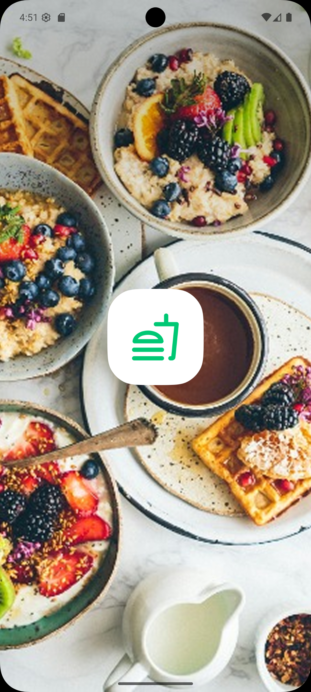 | 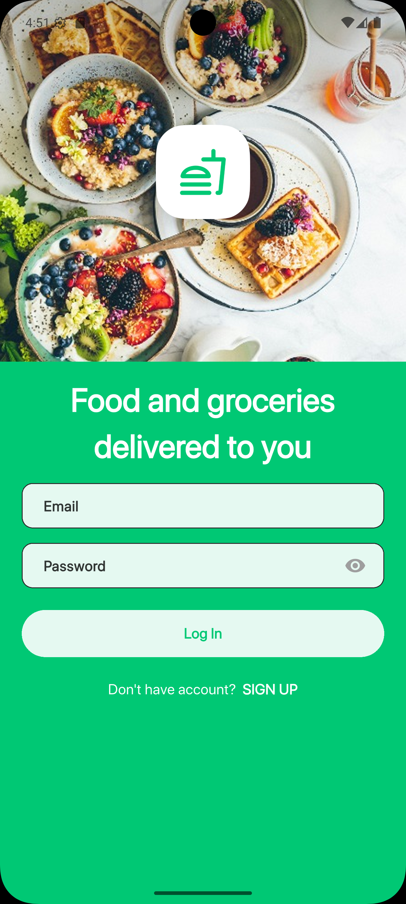 | 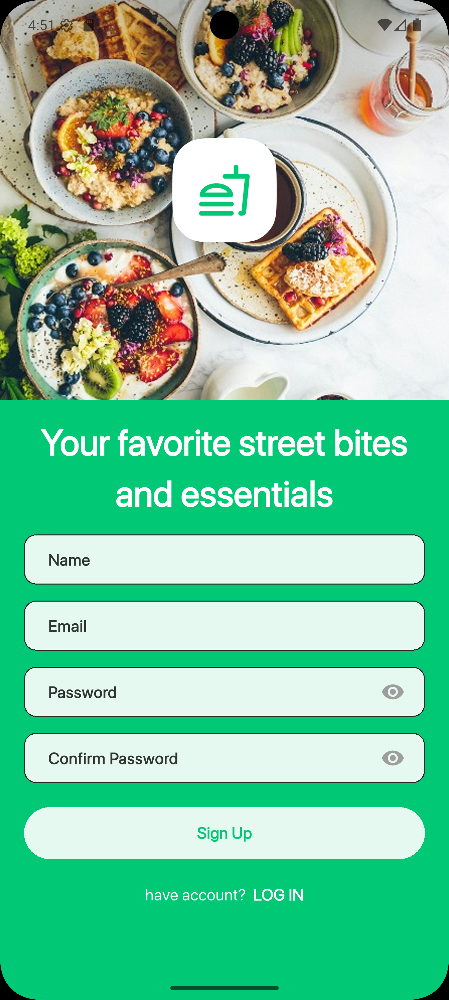 |
| Animated Branding & Logo | Firebase Email/Password Auth | New Account Creation |

| Login Validation Errors | Register Validation Errors | Login Error Dialog (AR) |
| :---: | :---: | :---: |
| 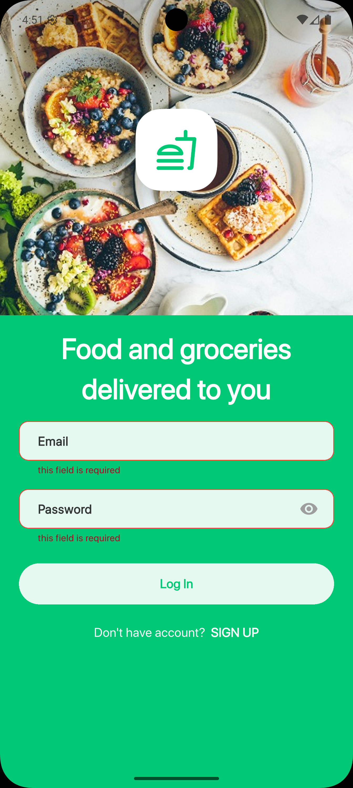 | 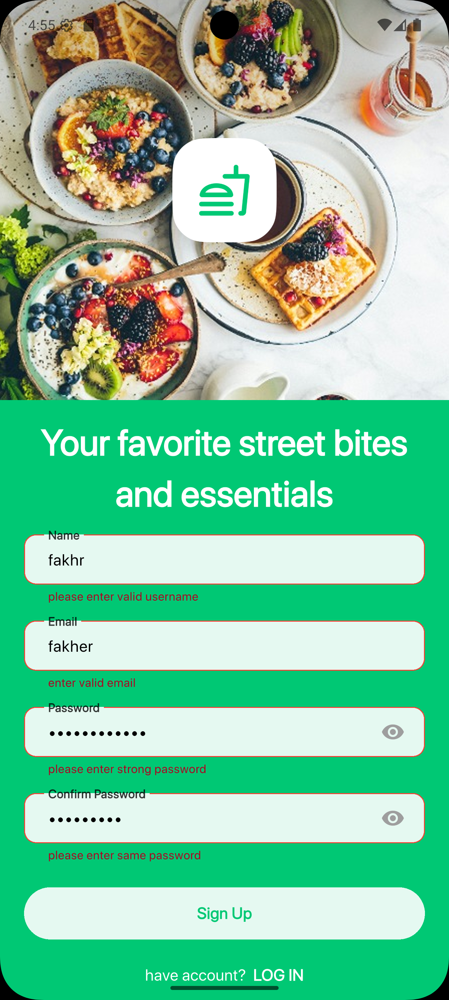 | 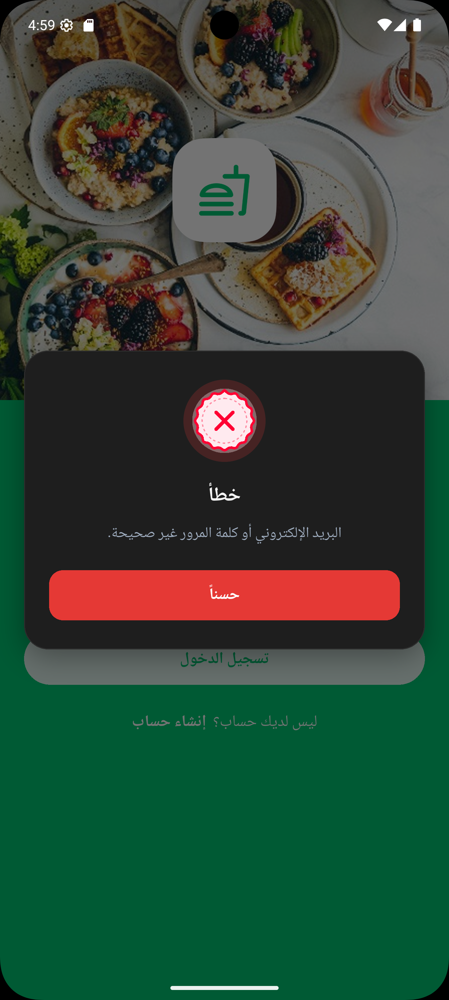 |
| Real-time Input Rules | Password & Email Checks | Localized Firebase Failures |

---

### 2. Home Feed, Meal Discovery & Theming

| Home Screen (Light EN) | Home Screen (Dark AR) | Meal Details View |
| :---: | :---: | :---: |
| 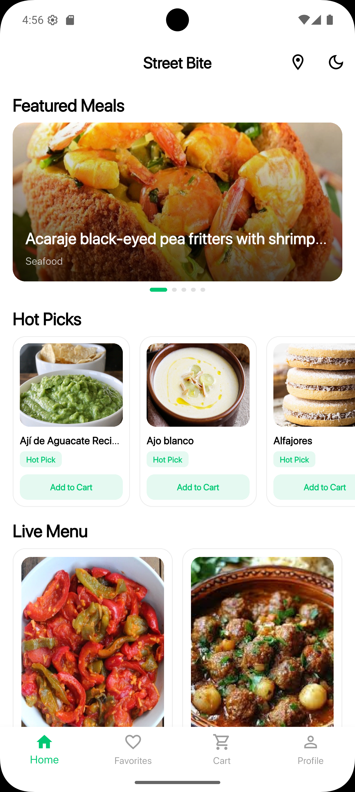 | 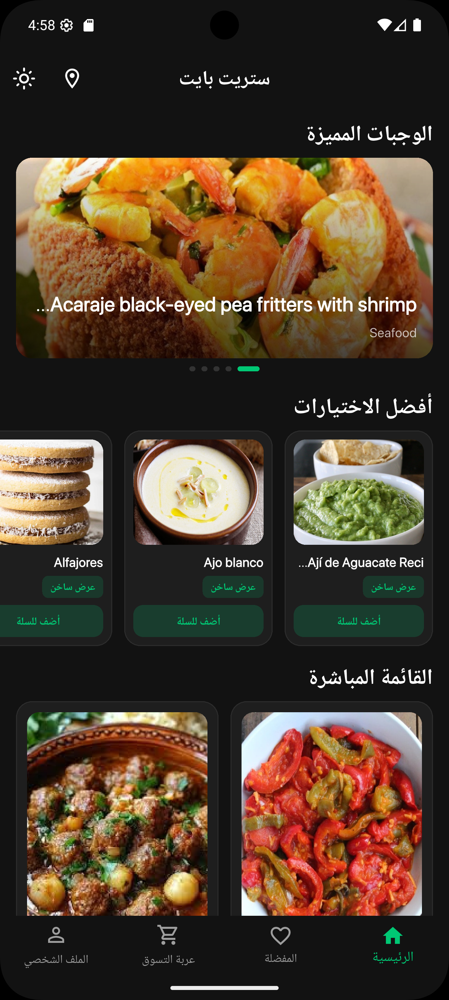 | 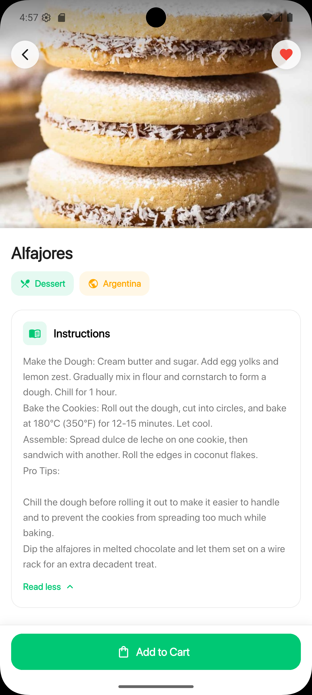 |
| Featured Banners & Hot Picks | Dark Theme with RTL Layout | Ingredients, Tags & Steps |

---

### 3. Cart, Checkout & Orders Lifecycle

| Cloud Favorites | Shopping Cart | Checkout Payment Methods |
| :---: | :---: | :---: |
| 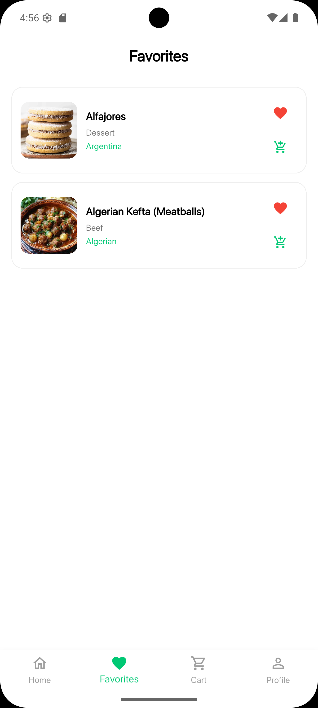 | 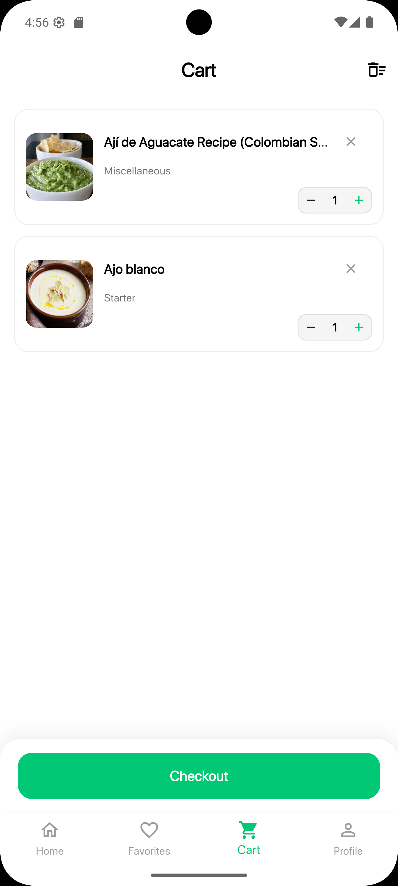 | 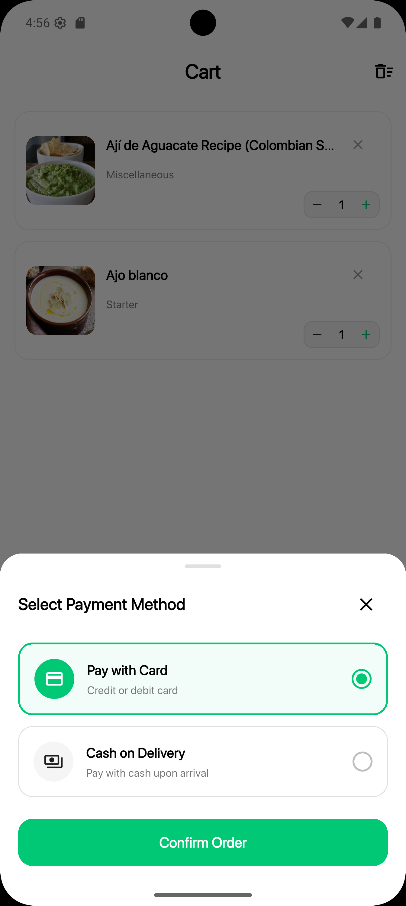 |
| Real-time Firestore Sync | Quantity Adjustments & Totals | Cash, Cards & Mobile Wallets |

---

### 4. Interactive Vendor Map & Biometric Security

| Nearby Vendors Map | Biometric Security Gate | Profile & Logout (AR) |
| :---: | :---: | :---: |
| 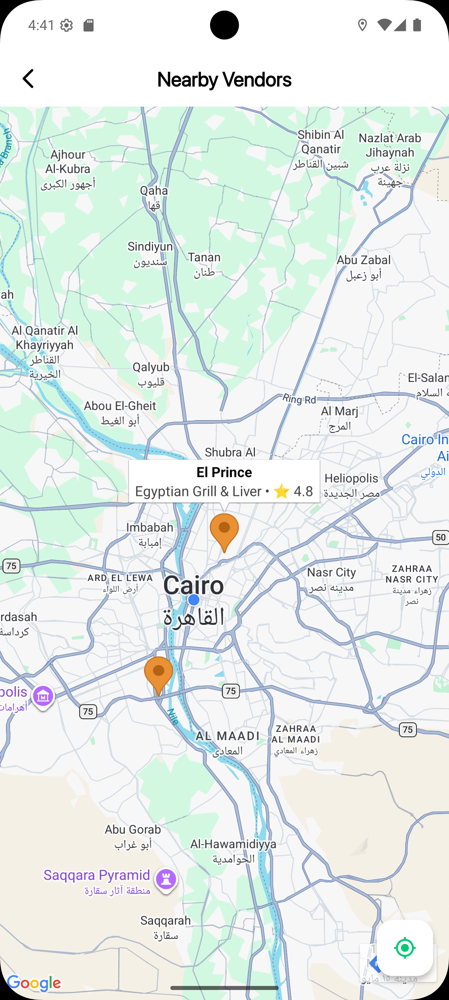 | 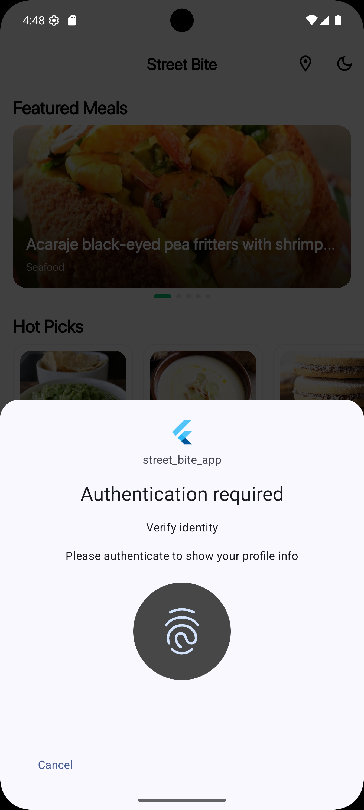 | 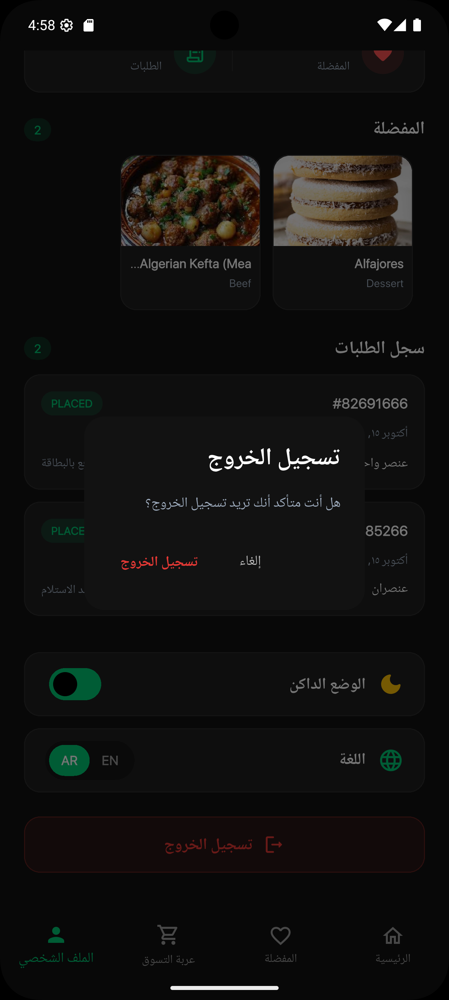 |
| Google Maps with Custom Markers | Fingerprint / Face ID Interceptor | Account Management & Sign Out |

---

### 5. Arabic Localization, Feedback & App Distribution

| Arabic Login (RTL) | In-App Feedback & SnackBar | Firebase Distribution Email | Firebase Testers Console |
| :---: | :---: | :---: | :---: |
| 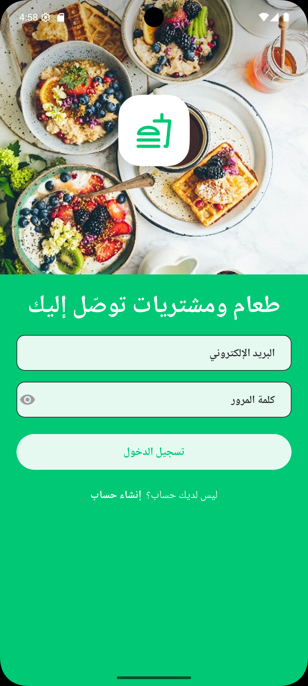 | 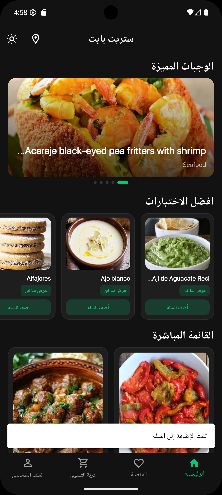 | 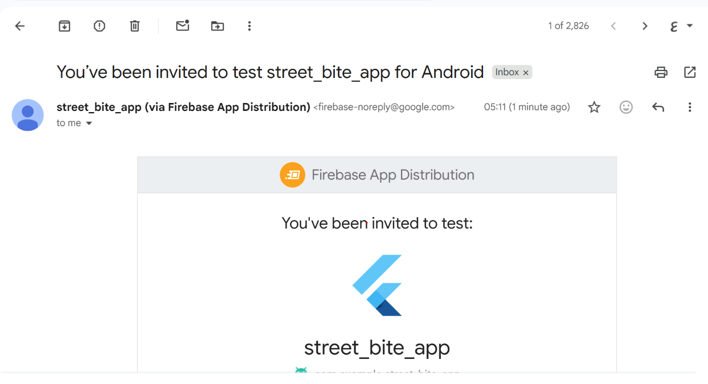 | 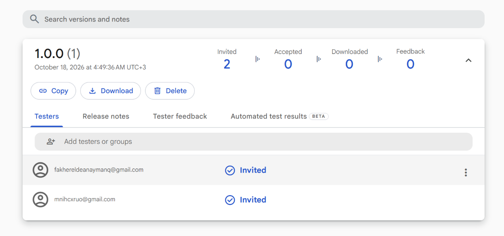 |
| Full RTL Form Layout | Instant Contextual Alerts | Tester Invitation Dispatch | Active Release Management |

---

## 🏛️ Architecture & Project Structure

The project strictly adheres to **Clean Architecture** with a **Feature-First** modular organization:

```
lib/
├── core/                   # Shared infrastructure, services & utilities
│   ├── api/                # Dio client, Endpoints & Network Constants
│   ├── cache/              # SharedPreferences persistence utilities
│   ├── config/             # Light & Dark theme definitions, App Colors
│   ├── di/                 # Dependency Injection via GetIt service locator
│   ├── errors/             # Failures & Exception handling models
│   ├── localization/       # Language Cubit & Locale controllers
│   ├── services/           # Firebase Auth, Cloud Firestore & Biometric services
│   ├── utils/              # Validators, Constants & Navigation helpers
│   └── widgets/            # Generic custom buttons, text fields, dialogs
│
└── features/               # Self-contained feature modules
    ├── auth/               # Login & Register (Data, Domain, Presentation)
    ├── home/               # Meal discovery feeds & Details (Data, Domain, Presentation)
    ├── cart/               # Cart state, item storage & Checkout (Data, Domain, Presentation)
    ├── favorites/          # Firestore favorites sync (Data, Domain, Presentation)
    ├── vendor_map/         # Google Maps live vendor tracking & markers
    ├── profile/            # User account details & Biometric security barrier
    ├── main_navigation/    # Bottom navigation bar & Theme switching cubit
    └── splash/             # Startup animated splash screen
```

### Architectural Principles

* **Separation of Concerns:**
  * **Presentation:** Screens, independent widget classes, and BLoC / Cubits managing reactive UI states.
  * **Domain:** Pure Dart Entities, UseCases encapsulating single business actions, and abstract Repository contracts.
  * **Data:** Remote Data Sources (Dio REST client, Firebase Firestore & Auth), Local Data Sources (SharedPreferences), Data Models with serialization, and Repository implementations.
* **Granular UI Decomposition:** Strictly zero monolithic widget methods; every reusable UI component is structured as a standalone `StatelessWidget` or `StatefulWidget` in its own file.
* **Dependency Injection:** Centralized, declarative service location handled via `get_it`.
* **Functional Error Handling:** Type-safe error propagation across layers utilizing `dartz` (`Either<Failures, T>`).

---

## ⚙️ Key Features

* **Authentication & User Management:**
  * Firebase Email & Password authentication.
  * Real-time client-side validation for emails, strong passwords, and usernames.
  * Localized user-friendly error alerts and dialogs for auth failures.

* **Meal Catalog & Multi-Section Discovery:**
  * Integrated with **TheMealDB REST API** via Dio.
  * Dynamic home feed featuring **Featured Meal Carousels**, **Hot Picks**, and a **Live Menu 2-column Grid**.
  * Detailed recipe views including category tags, ingredients list, instructions, and direct cart actions.

* **Persistent Cart & Checkout System:**
  * Multi-item cart management with quantity increment/decrement controls.
  * Real-time order price breakdowns with automated subtotal and fee calculation.
  * Modal bottom sheet checkout supporting **Cash on Delivery**, **Credit/Debit Cards**, and **Mobile Wallets**.
  * Completed orders persisted directly to Cloud Firestore.

* **Cloud-Synced Favorites:**
  * Instant toggling of meal favorites from home cards or meal detail screens.
  * Cloud Firestore synchronization tied to authenticated user IDs.

* **Google Maps Vendor Locator:**
  * Interactive Google Maps integration with custom food truck markers.
  * Real-time user GPS position acquisition via `geolocator`.
  * Vendor info modals displaying vendor names, ratings, distance, and coordinates.

* **Biometric Security Layer:**
  * Biometric authentication (`local_auth`) guarding sensitive screens (Profile).
  * Device hardware verification for fingerprint and Face ID availability before prompt.

* **Theme & Bilingual Localization (EN / AR):**
  * Instant Light and Dark mode switching powered by `ThemeCubit`.
  * Full Arabic and English localization with automatic RTL layout switching using `intl` and `flutter_intl`.

* **Continuous Delivery with Firebase:**
  * Configured with Firebase App Distribution for automated QA testing and tester builds.

---

## 🔌 APIs & Cloud Services Integration

| Service / API | Layer / Method | Responsibility |
| :--- | :--- | :--- |
| **TheMealDB API** | `Dio.get(search.php / lookup.php)` | Fetches live meal recipes, categories, ingredients, and thumbnail assets. |
| **Firebase Auth** | `signInWithEmailAndPassword` / `createUserWithEmailAndPassword` | Secure user registration, credential authentication, and session tokens. |
| **Cloud Firestore** | Collections: `users`, `favorites`, `orders` | Real-time cloud persistence for user profiles, bookmarked items, and orders. |
| **Google Maps SDK** | `GoogleMap` widget | Renders map tiles, zoom controls, and interactive food truck markers. |
| **Geolocator** | `Geolocator.getCurrentPosition()` | Accurately pinpoints client GPS location to calculate nearby vendors. |
| **Local Auth** | `LocalAuthentication.authenticate()` | Hardware biometric verification protecting profile access. |

---

## 🚀 Getting Started

### Prerequisites

* Flutter SDK (`>= 3.13.4`)
* Dart SDK (`>= 3.13.4`)
* Active Google Maps API Key (configured in `AndroidManifest.xml` / `AppDelegate.swift`)
* Configured Firebase project (`firebase_options.dart`)

### Setup Steps

1. **Clone the repository:**

   ```bash
   git clone https://github.com/FakhrElddin/street_bite_app.git
   cd street_bite_app
   ```

2. **Install dependencies:**

   ```bash
   flutter pub get
   ```

3. **Configure Google Maps API Key:**
   
   Add your Google Maps API key to:
   - Android: `android/app/src/main/AndroidManifest.xml`
     ```xml
     <meta-data
         android:name="com.google.android.geo.API_KEY"
         android:value="YOUR_GOOGLE_MAPS_API_KEY"/>
     ```
   - iOS: `ios/Runner/AppDelegate.swift`
     ```swift
     GMSServices.provideAPIKey("YOUR_GOOGLE_MAPS_API_KEY")
     ```

4. **Run the application:**

   ```bash
   flutter run
   ```

---

## 🛣️ Sprint Milestones & Roadmap

- [x] **Splash & Onboarding:** Animated splash with branding and auto-routing.
- [x] **Authentication:** Firebase Login & Registration with real-time validation and error dialogues.
- [x] **Meal Discovery:** TheMealDB integration with Featured carousel, Hot Picks, and Live Menu grid.
- [x] **Recipe Details:** Ingredients list, instruction steps, tags, and cart/favorite integration.
- [x] **Cart & Checkout:** Multi-item cart management, price calculations, and multi-payment checkout.
- [x] **Cloud Favorites:** Real-time Firestore sync for meal bookmarks.
- [x] **Google Maps Vendor Locator:** Live GPS tracking with interactive vendor markers and cards.
- [x] **Biometric Security:** Fingerprint / Face ID interceptor protecting the Profile tab.
- [x] **Theming & Localization:** Dark/Light theme switching and English/Arabic RTL support.
- [x] **Continuous Distribution:** Firebase App Distribution integration for QA releases.

---

<div align="center">
  <sub>Developed by <strong>Fakhr Elddin</strong> • Street Bite App</sub>
</div>
